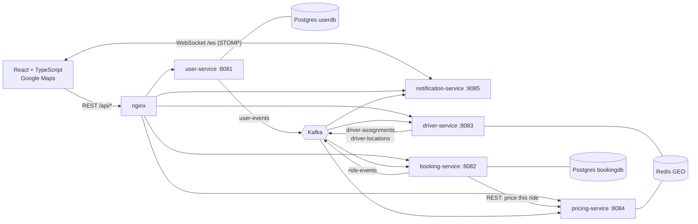
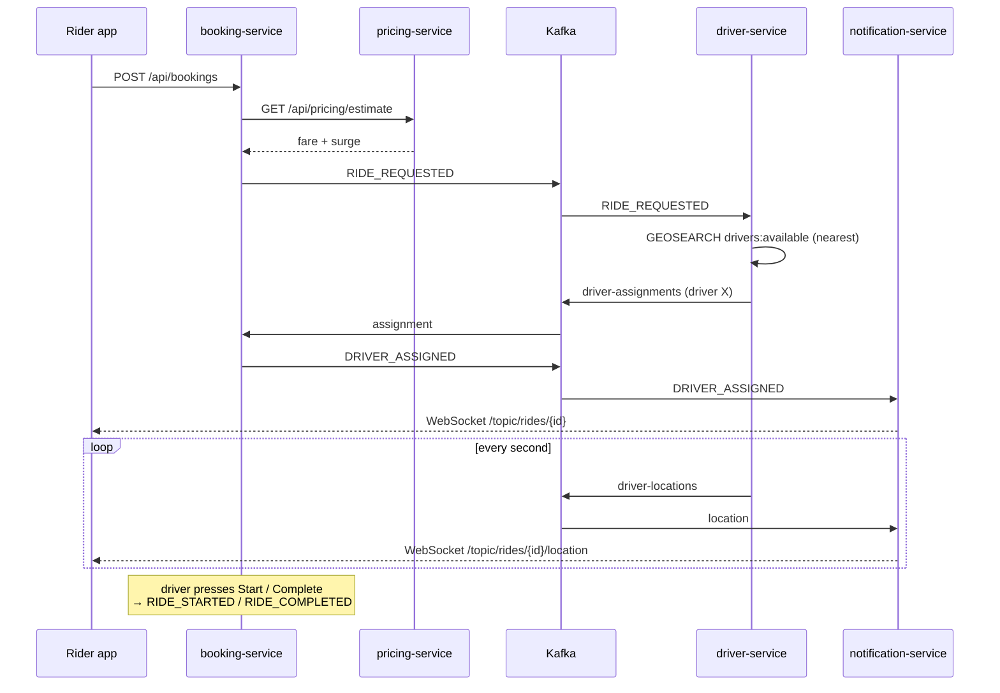

# RideFlow: Real-Time Cab Booking & Driver Tracking

An Uber-style ride booking platform built as **event-driven Spring Boot microservices**.
Riders pick a pickup and drop on a map, see live prices with **surge pricing**, get matched
to the **nearest driver in under a millisecond using Redis GEO**, and watch the car move
towards them **live over WebSockets**.

**Tech stack:** Spring Boot 3 · Java 17 · Apache Kafka · Redis GEO · PostgreSQL · JWT · WebSockets (STOMP) · React 18 + TypeScript · Google Maps SDK · Docker · GitHub Actions

---

## What it does

| Feature | How |
|---|---|
| Sign up / log in as rider or driver | `user-service` issues a **JWT**; every service validates it |
| See free drivers around you | `driver-service` runs **Redis `GEOSEARCH`** (lookup time is shown in the UI) |
| Fare estimate for Mini / Sedan / SUV | `pricing-service`: distance + time + **dynamic surge** |
| Book a ride, get the nearest driver | `booking-service` → Kafka → `driver-service` matches with Redis GEO |
| Live driver tracking on the map | driver location → Kafka → `notification-service` → **WebSocket** → Google Map |
| Ride lifecycle: requested → assigned → started → completed / cancelled | Kafka topic `ride-events` |
| Rate your driver, ride history, driver earnings | `booking-service` + React pages |
| Works with one browser tab | Built-in **driver simulator** (bot drivers that really drive to you) |

---

## Architecture



### The five services

| Service | Port | Owns | Responsibility |
|---|---|---|---|
| `user-service` | 8081 | Postgres `userdb` | Register, login, BCrypt passwords, issue JWTs |
| `booking-service` | 8082 | Postgres `bookingdb` | **Single owner of ride state.** Every change is saved, then published to `ride-events` |
| `driver-service` | 8083 | Redis | Online/offline, live locations (Redis GEO), nearest-driver matching, bot simulator |
| `pricing-service` | 8084 | Redis (read) | Fare estimates + surge based on supply/demand near the pickup |
| `notification-service` | 8085 | none | Consumes Kafka and pushes events to browsers over WebSocket |

`backend/common` is a shared library (not a service): JWT filter + security config, Kafka event classes, topic names, geo helpers.

### Kafka topics

| Topic | Producer | Consumers | Payload |
|---|---|---|---|
| `ride-events` | booking-service | driver, pricing, notification | `RideEvent` (full ride snapshot + type) |
| `driver-assignments` | driver-service | booking-service | `DriverAssignmentEvent` (who got the ride, or nobody) |
| `driver-locations` | driver-service | notification-service | `DriverLocationEvent` |
| `user-events` | user-service | notification-service | `UserRegisteredEvent` (welcome message) |

The booking id is used as the Kafka message key, so all events of one ride go to the same partition and are processed **in order**.

### Ride lifecycle



### Redis GEO keys

| Key | Type | Used for |
|---|---|---|
| `drivers:locations` | GEO set | every online driver |
| `drivers:available` | GEO set | only free drivers → **nearest-driver lookup** and **surge supply** |
| `rides:active` | GEO set | pickup points of active rides → **surge demand** |
| `driver:{id}` | Hash | status, name, vehicle, current booking |

### Surge pricing

```
supply = free drivers within 3 km of the pickup      (GEOSEARCH drivers:available)
demand = active rides within 3 km of the pickup      (GEOSEARCH rides:active)
surge  = (demand + 1) / (supply + 1), kept between 1.0x and 2.5x
fare   = (base + perKm × km + perMin × minutes) × surge
```
Book a few rides quickly and watch the price go up as the simulated drivers get busy.

---

## Run it (Docker, recommended)

**Requirements:** [Docker Desktop](https://www.docker.com/products/docker-desktop/) with about **6 GB of memory** allowed (Settings → Resources).

```bash
git clone https://github.com/<your-username>/rideflow.git
cd rideflow
cp .env.example .env          # optional: add a Google Maps key here
docker compose up --build
```

The first build takes a few minutes (Maven and npm download dependencies). When the logs calm down, open:

| URL | What |
|---|---|
| http://localhost:3000 | **The app** |
| http://localhost:8090 | Kafka UI: watch events flow through the topics |

### Try it

1. Click **Demo rider** (or log in with `rider@demo.com` / `password123`).
2. You'll see 6 simulated cars. Click the map once for **pickup**, once for **drop**.
3. Pick Mini / Sedan / SUV and press **Book**.
4. The nearest car is assigned instantly and drives to you, starts the trip, and drives to the drop, live on the map.
5. Rate the driver, then check **Your trips**.

**Testing as a real driver:** open a second tab (each tab has its own login), click **Demo driver**, click the map close to where the rider will be, and press **Go online**. When the rider books near you, the ride appears in the driver tab. Tick **Drive there for me** to simulate GPS, then **Start trip** and **Complete trip**.
Tip: set `SIMULATOR_ENABLED=false` in `.env` so the bots don't take the ride first.

### Google Maps (optional)

Without a key the app uses a simple built-in map, so everything still works. For real streets:
1. Create a key in [Google Cloud Console](https://console.cloud.google.com/google/maps-apis) and enable **Maps JavaScript API**.
2. Put it in `.env`: `GOOGLE_MAPS_API_KEY=your-key`
3. `docker compose up --build frontend`

### Change the city

The bots drive around Bengaluru by default. Set `CITY_CENTER_LAT` / `CITY_CENTER_LNG` in `.env` and rebuild.

### Stop / reset

```bash
docker compose down        # stop
docker compose down -v     # stop and delete the database
```

---

## Run without Docker (for development)

You need Java 17, Maven 3.9 and Node 20.

```bash
# 1. infrastructure only
docker compose up -d postgres redis kafka

# 2. build the backend once
mvn -f backend/pom.xml install -DskipTests

# 3. start each service in its own terminal
java -jar backend/user-service/target/app.jar
java -jar backend/pricing-service/target/app.jar
java -jar backend/booking-service/target/app.jar
java -jar backend/driver-service/target/app.jar
java -jar backend/notification-service/target/app.jar

# 4. frontend (Vite proxies /api and /ws to the services)
cd frontend
cp .env.example .env.local   # optional Google Maps key
npm install
npm run dev                  # http://localhost:5173
```

You can also open `backend/` in IntelliJ IDEA and run each `*Application` class.

---

## API reference

All endpoints except login/register and pricing need `Authorization: Bearer <token>`.

| Method | Path | Who | Description |
|---|---|---|---|
| POST | `/api/auth/register` | anyone | `{name, email, password, role: RIDER\|DRIVER, vehicle?}` → `{token, user}` |
| POST | `/api/auth/login` | anyone | `{email, password}` → `{token, user}` |
| GET | `/api/users/me` | any | current user |
| GET | `/api/pricing/estimate?pickupLat&pickupLng&dropLat&dropLng&rideType` | anyone | fare + surge |
| POST | `/api/bookings` | rider | `{pickupLat, pickupLng, dropLat, dropLng, rideType}` |
| GET | `/api/bookings/active` | any | current ride (204 if none) |
| GET | `/api/bookings/my` | any | ride history |
| GET | `/api/bookings/{id}` | rider/driver of ride | one ride |
| POST | `/api/bookings/{id}/cancel` | rider | before the trip starts |
| POST | `/api/bookings/{id}/start` | assigned driver | |
| POST | `/api/bookings/{id}/complete` | assigned driver | |
| POST | `/api/bookings/{id}/rate` | rider | `{rating: 1-5}` |
| POST | `/api/drivers/online` / `offline` | driver | `{lat, lng}` |
| POST | `/api/drivers/location` | driver | `{lat, lng}` |
| GET | `/api/drivers/me` | driver | status from Redis |
| GET | `/api/drivers/nearby?lat&lng&radiusKm` | any | free drivers + `lookupMs` |
| GET | `/api/drivers/{id}/location` | any | last position |

**WebSocket:** connect STOMP to `/ws` with header `Authorization: Bearer <token>`, then subscribe to
`/topic/rides/{bookingId}`, `/topic/rides/{bookingId}/location`, `/topic/drivers/{driverId}`.

---

## Project structure

```
rideflow/
├── backend/
│   ├── pom.xml                  # Maven parent (Spring Boot 3.3)
│   ├── Dockerfile               # one Dockerfile, --build-arg SERVICE=<name>
│   ├── common/                  # JWT security, Kafka events & topics, geo utils
│   ├── user-service/
│   ├── booking-service/
│   ├── driver-service/          # includes simulator/BotDriverSimulator
│   ├── pricing-service/
│   └── notification-service/
├── frontend/
│   ├── src/
│   │   ├── pages/               # Login, Register, RiderDashboard, DriverDashboard, History
│   │   ├── components/          # MapView (Google Maps / lite map), RideProgress, Layout
│   │   ├── api.ts  ws.ts  auth.tsx
│   ├── nginx.conf               # routes /api/* and /ws to the services
│   └── Dockerfile
├── infra/postgres/init.sql      # creates userdb + bookingdb
├── docker-compose.yml
├── .github/workflows/ci.yml     # build, test, Docker images → GHCR
└── docs/HOW_IT_WORKS.md         # plain-English walkthrough for interviews
```

## CI/CD

`.github/workflows/ci.yml` runs on every push and pull request:
1. **Backend:** `mvn verify` builds all services and runs the unit tests (JWT, geo maths, pricing/surge).
2. **Frontend:** `npm ci` + TypeScript type-check + production build.
3. **Docker:** builds an image for each service; on `main` it pushes them to GitHub Container Registry as `ghcr.io/<you>/rideflow-<service>`.

---

## Push this project to your GitHub

1. Create an **empty** repository on GitHub named `rideflow` (no README, no .gitignore).
2. In this folder:
   ```bash
   git init
   git add .
   git commit -m "RideFlow: real-time cab booking platform"
   git branch -M main
   git remote add origin https://github.com/<your-username>/rideflow.git
   git push -u origin main
   ```
3. Open the **Actions** tab on GitHub to watch the pipeline run.

## Troubleshooting

| Problem | Fix |
|---|---|
| A service exits on first start | Kafka was still starting. Run `docker compose up` again, or `docker compose restart <service>` |
| "No drivers nearby" | Pick a pickup near the cars on the map (bots are within ~2 km of the city centre) |
| Containers killed / very slow | Give Docker more memory (6 GB+) |
| Google map says "For development purposes only" / error | Key missing billing or the Maps JavaScript API is not enabled. Remove the key to use the built-in map |
| Port already in use | Change the left side of the `ports:` mapping in `docker-compose.yml` |

## License

MIT
